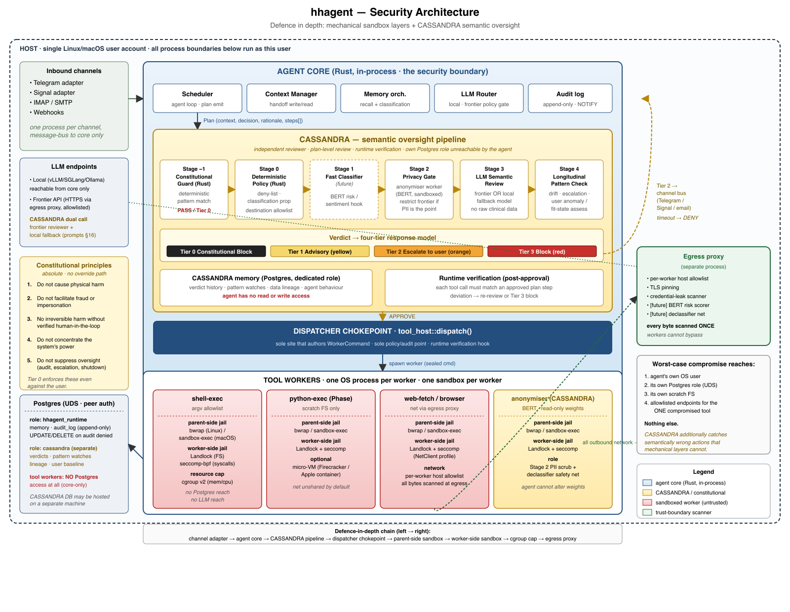
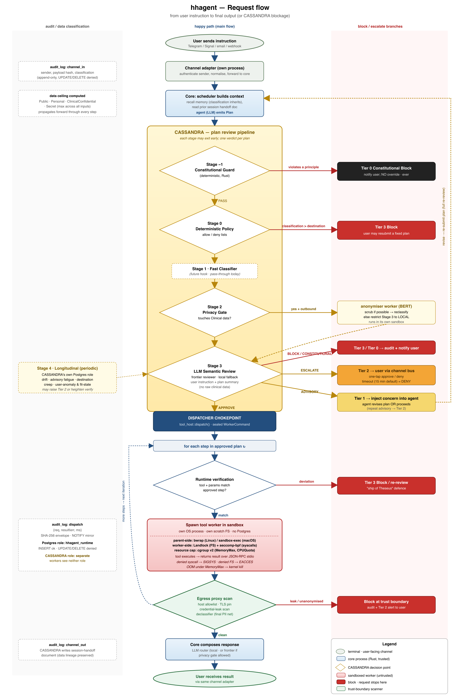

# Kastellan - the *trustworthy* personal autonomous agent

<p align="center">
  
</p>

> A castellan is the officer a lord entrusts to hold a stronghold:
> full authority within the walls, none to act beyond them.

Kastellan is a personal, always-on AI agent built so that security is its
foundational property, not a layer added later. It talks to you over Matrix —
self-hosted, single-user, federation off, end-to-end encrypted — with email as
a low-trust failover, drives a browser, searches and fetches the web, executes
Python, and maintains persistent memory in Postgres with hybrid retrieval. But
every tool runs inside its own
kernel sandbox, bounded to that tool's own allowlist, and every plan it forms
is first reviewed by **CASSANDRA** — a semantic oversight layer enforcing five
constitutional constraints that no user, admin, or configuration change can
override.

The name is the design. Kastellan acts on your behalf and runs unattended,
but only ever within boundaries it cannot widen for itself: mechanical ones
(the OS process boundary, with bubblewrap, Landlock, and seccomp) and semantic
ones (CASSANDRA). It is vendor-neutral by construction — the primary host is
the NVIDIA DGX Spark, but nothing in the core requires NVIDIA or a specific
cloud, and Linux and macOS are both first-class. The core is small and Rust,
with no eval, no metaprogramming, and no dynamic import; Python lives only
inside sandboxed workers.

## What it is

A long-running personal AI agent designed to:

- talk to you over Matrix (self-hosted, single-user, federation off, end-to-end encrypted), with email (its own IMAP/SMTP account) as a low-trust cross-transport failover
- remote-control a web browser, perform web searches and page fetches
- execute Python in a strict sandbox
- maintain persistent memory in Postgres with hybrid retrieval (pgvector + lexical + graph)
- review its own plans through **CASSANDRA**, a semantic oversight layer with hard-coded constitutional constraints, before any tool runs
- run continuously, periodically resetting its context window from memories and a persistent task list

Not all of this is built yet — see [Status](#status) for what works today versus
what's still on the roadmap.

> **New here?** The [**User Manual**](docs/user/manual/index.md) explains — in
> plain language, for non-developers — what Kastellan is, how it's built, how it
> protects you, and how to set it up and run it.

## Design priorities (in order)

1. **Security boundary = the agent's own OS user account.** Worst-case compromise (LLM, tool, dependency, or LLM-authored Python) does not escape that boundary.
2. **Vendor neutrality.** Primary host is the NVIDIA DGX Spark, but no hard NVIDIA dependency. Linux and macOS are both first-class.
3. **License hygiene.** Project is AGPL-3.0; every dependency is AGPL-compatible.
4. **Small core.** The agent core is Rust (no eval, no metaprogramming, no dynamic import). Python lives only inside sandboxed workers.

## Security architecture

<p align="center">
  
</p>

The mechanical layers along the bottom of the diagram — bwrap, Landlock,
seccomp, the egress proxy, the dispatcher chokepoint — enforce *boundaries*:
"this process cannot open that socket." The **CASSANDRA** layer running
alongside the agent core enforces *intent*: "should the agent be doing this
at all, given what the user actually asked for?" CASSANDRA reviews each
plan (not each tool call) through a pipeline of deterministic and LLM
stages, with five hard-coded constitutional constraints that no user,
admin, or configuration change can override. See
[`docs/cassandra_design_plan.md`](docs/cassandra_design_plan.md).

The diagram below traces a single user instruction through every gate —
channel ingress, plan formulation, the CASSANDRA review pipeline
(Stages −1 through 4), the dispatcher chokepoint, sandboxed worker
execution, and the egress proxy — with the block / advisory / escalation
branches drawn explicitly. Source: [`docs/security-request-flow.svg`](docs/security-request-flow.svg).

<p align="center">
  
</p>

## Why another one?

Several Rust personal-agent projects exist in the OpenClaw-derived
family — notably [IronClaw](https://github.com/nearai/ironclaw) and
[ZeroClaw](https://github.com/zeroclaw-labs/zeroclaw). They share a lot
with kastellan: Rust core, local-first, OS sandboxing, MCP-compatible IPC.
The reason for *another* one is posture, not feature count: **security
is the foundational property here, not a layer added later.** Each rule
below is a load-bearing invariant, not a default we relax under deadline
pressure.

- **One OS process + one kernel sandbox per tool invocation.** IronClaw
  runs tools as WASM modules inside the runtime; ZeroClaw runs them as
  in-process Rust traits with the OS sandbox wrapping the *whole*
  runtime. Both are software-only or coarse-grained boundaries.
  kastellan's boundary is the OS process boundary — `bubblewrap` on
  Linux, `sandbox-exec` on macOS — so a compromised tool reaches at
  most the endpoints in *that tool's* allowlist, never the next
  tool's, and never the core.

- **Double containment.** The parent installs the OS sandbox at spawn;
  the worker then installs a *second* layer on itself
  (Landlock + seccomp-bpf on Linux) before serving any JSON-RPC
  request. A kernel bug in either layer alone does not breach the
  worker. See [`workers/prelude/`](workers/prelude/).

- **seccomp is an allow-list, not a deny-list.** Default action is
  `KillProcess`; ~110 base syscalls plus per-profile additions
  (e.g. the BSD-socket family for `WorkerNetClient`) are explicitly
  permitted. The kill-list-of-obviously-bad-calls posture common
  elsewhere lets new attack syscalls walk in unchallenged every time
  the kernel grows.

- **Dispatcher chokepoint.** A single function authors every
  `WorkerCommand`, consults policy, and writes the audit-log entry.
  New channels (the Matrix client, the email failover) and scheduled
  routines call into it — they never spawn workers themselves. Borrowed from
  IronClaw's `ToolDispatcher::dispatch()` and made non-negotiable.

- **Semantic oversight on top of mechanical sandboxing
  (CASSANDRA).** Kernel sandboxes catch "this process tried to open
  that socket"; they cannot catch "send this confidential pathology
  report to a recipient who happens to be permitted but contextually
  wrong." Every plan the agent formulates is reviewed by CASSANDRA
  before any tool runs — a chain of deterministic and LLM stages
  enforcing five **constitutional constraints** (no physical harm,
  no fraud / impersonation, no irreversible action without verified
  human-in-the-loop, no power concentration, no oversight
  suppression) that no user, admin, or configuration change can
  override. Runtime verification at the dispatcher then re-checks
  that what executes matches what was approved. The agent core never
  bypasses this gate. See
  [`docs/cassandra_design_plan.md`](docs/cassandra_design_plan.md).

- **AGPL with AGPL-compatible deps only.** No CDDL, BUSL, SSPL,
  Elastic License, or "source-available" components. License hygiene
  is part of the security boundary: a permissive dep can re-enter the
  process under a corporate fork the user cannot audit.

- **Cross-platform parity by construction.** The same `SandboxPolicy`
  struct drives both backends. Linux's stronger stack
  (bwrap + Landlock + seccomp) and macOS's weaker stack (Seatbelt) are
  both first-class with negative tests asserting that denials actually
  deny. The asymmetry between them is documented openly in
  [`docs/threat-model.md`](docs/threat-model.md) rather than papered
  over.

- **No vendor lock-in.** Primary host is the NVIDIA DGX Spark, but
  nothing in the core requires NVIDIA, CUDA, or a specific cloud.
  Local LLMs run via Ollama (the installer's default), vLLM or SGLang on
  Linux, and oMLX (the default), llama.cpp or Ollama on macOS — all behind
  an OpenAI-compatible HTTP API.

The full set of invariants — including secret handling, single-point
egress inspection, and the "no in-process untrusted code" rule — lives
in [`docs/architecture.md`](docs/architecture.md). Reviewers are
expected to refuse PRs that violate them.

## Status

**Pre-release; deployed and in daily use on its primary host.** The sandboxed
core, memory and agent loop are built. The egress boundary is complete and
force-routed by default. The Matrix channel is live end-to-end, and so is the
operator Inbox, where CASSANDRA's "a human must decide" verdicts reach you. The
gated inbound half of the email failover has shipped. python-exec runs with
operator-approved, agent-authored skills. An optional model-based guard screens
tool output. The planner has a second, notebook-style mode for long tasks. The
project is a Rust workspace of 27 crates (v0.2.0 on crates.io) with real
cross-platform sandboxing, including opt-in micro-VM backends on both OSes.

What works today:

- **Sandboxing — double-contained, cross-platform.** On Linux, `bubblewrap` +
  Landlock + seccomp-bpf, wrapped in a `systemd-run --scope` cgroup for CPU and
  memory caps. Linux also has an opt-in Firecracker micro-VM backend whose guest
  kernel is sha256-pinned and verified at every VM boot. On macOS,
  `sandbox-exec` (Seatbelt), plus an opt-in Apple `container` micro-VM backend.
  Each worker gets one OS process and one kernel sandbox. A single
  `SandboxPolicy` drives every backend, and negative tests check that denials
  actually deny.
- **Agent loop + scheduler.** A Postgres-backed task queue (`LISTEN/NOTIFY`,
  leased claims, fast and long lanes) runs the cycle: LLM plan → **CASSANDRA**
  review → dispatcher chokepoint → sandboxed step. Every lifecycle transition
  writes an append-only audit row, and a crash-recovery sweep picks up
  interrupted work. Planner calls are bounded:
  - a token cap (`max_tokens`) and a call timeout on every call;
  - a `plan_budget` the model can see;
  - a 15-minute ceiling on the fast lane;
  - a re-ask when the model's reply is not a plan.

  The thinking/reasoning switch is per backend (`KASTELLAN_LLM_THINKING_SWITCH`).
- **Two planner modes** (`KASTELLAN_PLANNER_MODE`):
  - `classic` (the default) keeps one growing plan.
  - `notebook` is external working memory for the planner. The model writes its
    own step list and works one step per turn. It ticks off each step with a
    note and keeps *findings*: facts together with their source. It writes the
    answer from those findings. A `sift` step runs its reads as one reviewed
    plan into an append-only scrapbook, and answer tables are rendered by code,
    not by the model.

  Channel conversations keep their continuity across turns.
- **CASSANDRA oversight.** The constitutional and deterministic
  (data-classification) policy stages have an offline replay/iteration harness.
  A worker-output prompt-injection guard redacts and audits blocked content.
  An `Escalate` verdict suspends the task and puts a question in the **operator
  Inbox**. You answer it in your Matrix room or with `kastellan-cli inbox`.
  Answers come from a closed set (approve / deny), are matched by an
  unforgeable per-ask nonce, and carry a mandatory deadline: an unanswered ask
  fails the task closed.
- **Guard tier (optional, advisory).** A small local safety model (Shieldstral
  via `llama-server`) gives a second opinion on tool output that the pattern
  screen let through. It can run as a supervised `kastellan-guard` unit that
  starts before the agent. It is defence-in-depth, never a gate: nothing
  downstream relaxes because it is on. But a misconfigured guard **stops the
  daemon** rather than silently switching itself off.
- **Memory.** Recall runs four lanes over L1/L2/L4 — pgvector semantic,
  `tsvector` lexical, graph, and entity-similarity — fused with Reciprocal Rank
  Fusion. The prompt is assembled in layers: L0 meta-rules, the L1
  always-in-context index, and L3 approved skills, each through its own gated
  block, never through recall. Entity/relation extraction feeds a
  quarantine-review CLI. A handoff cache stashes oversized tool results whole.
- **L3 skill arc.** Crystallise a successful trajectory → operator approve/pin →
  surface in `<skills>` → re-invoke, with trust tiers and live re-validation at
  dispatch.
- **Workers.**
  - `shell-exec`: argv-allowlisted execve.
  - `web-fetch`: HTTPS-only, host-allowlisted, redirect- and size-capped
    readable-text extraction.
  - `web-search`: SearxNG-backed queries.
  - `web-research`: composite search → fetch → ranked passages in one call.
  - `mail`: read-only tools over a local [localmail](https://github.com/hherb/localmail)
    archive (API 1.6+) — search with attachment names, read, and attachments
    delivered to a durable per-task folder.
  - `gliner-relex`: Python entity/relation extraction under the sandbox.
  - `browser-driver`: opt-in, read-only Playwright render worker.
  - `python-exec`: the strictest jail of any worker — `Net::Deny`, ephemeral
    scratch only, curated stdlib; acceptance-green on Linux and macOS.

  Two trusted sidecars, `embed-broker` and `search-broker`, connect jailed
  workers to the embedding and search backends without widening their egress.
- **Egress boundary.** Every networked worker is **force-routed by default**
  through its own egress proxy. The worker sits in a private network namespace
  with no direct route out. The proxy:
  - enforces a host allowlist, resolves DNS itself, and rejects
    private/loopback/link-local IPs (SSRF);
  - intercepts TLS and scans the cleartext for the worker's own secrets (the
    credential-leak scanner);
  - pins server certificates;
  - audits every allow and block decision.

  An operator-configured extra CA (`KASTELLAN_EGRESS_UPSTREAM_EXTRA_CA`) lets
  the inspection leg reach one private, self-signed origin, such as a local
  mail archive. It is enforced to exactly one private origin and fails closed.
- **Channels.**
  - **Matrix (live):** self-hosted, single-user, federation off, end-to-end
    encrypted; `matrix-rust-sdk` runs inside a sandboxed worker. It carries the
    decision/message bus and the Inbox. Peer pairing is operator-issued,
    single-use and fail-closed, and inbound messages are screened for prompt
    injection.
  - **Email failover, inbound half (live; config-gated, off by default):** a
    sandboxed `email-in` worker polls a local mail archive through the
    intercepting proxy. A message is enqueued only with **both** a DMARC
    verdict stamped by the operator's own MX **and** a per-pairing in-body
    token.

  Every inbound and outbound message is audited. A reply that finished while
  no channel was listening is delivered later by a catch-up sweep. A lost
  audit row is reported, not dropped silently.
- **Operator CLI (`kastellan-cli`).**
  - `ask` submits a task and follows it live, printing each plan/step line.
  - `tasks list|status|tail|correct|cancel` manages tasks.
  - `inbox` answers the agent's questions.
  - `session` is a JSON-RPC 2.0 link on stdin/stdout, so a front end (over
    ssh, say) can submit, follow, correct and cancel tasks.
  - Also: `pair`, `secret`, `tools allowlist`, `memory`, `entities` /
    `relations` review, and `audit tail`.
- **Supporting infrastructure.** OS-native supervisor units (`systemd --user`
  / launchd) under a `kastellan.target`, with the core waiting out a
  late-starting Postgres. Secrets are encrypted at rest (AES-256-GCM) and
  referenced through opaque `secret://` handles. The LLM router is
  OpenAI-compatible and local-first. A one-command per-user installer and an
  upgrade script complete the set.

Not built yet (see the roadmap):

- **Outbound email** (SMTP, email-channel slice 2). Email replies are routed
  but not yet delivered, and audited as such.
- **MITM inspection of browser traffic.** It rides the proxy as an opaque
  tunnel today.
- **An LLM plan-review stage in CASSANDRA.** The constitutional and
  data-classification stages are deterministic rules; the guard model screens
  *content*, not plans.
- **Notebook as the default planner mode**, retiring `classic`.
- **Good-netizen behaviour in the web workers** — rate limiting, backoff,
  `robots.txt` — required before any release.
- **Context-window resets** from memory and the task list, and L4 session
  digests.
- **Tiered delegation** for agent-authored skills.
- **The frontier-egress worker**, which the certificate-pinning path is
  waiting on, and the Phase-5 frontier-escalation policy gate.

Day-to-day state — what's green and the next task — lives in
[`docs/devel/handovers/HANDOVER.md`](docs/devel/handovers/HANDOVER.md); the
sequenced build plan is [`docs/devel/ROADMAP.md`](docs/devel/ROADMAP.md). See also
[`docs/architecture.md`](docs/architecture.md) and
[`docs/threat-model.md`](docs/threat-model.md).

## Layout

Rust workspace, 27 crates (plus two Python workers outside Cargo):

```
core/                  kastellan-core: agent loop + scheduler (classic and notebook
                       planners, sift), memory, CASSANDRA + guard tier, operator Inbox,
                       audit, tool-host chokepoint, channel bus (Matrix + email),
                       egress integration, handoff cache, secrets vault, installer;
                       `kastellan` daemon + `kastellan-cli`
db/                    kastellan-db: Postgres helpers + embedded migrations (pgvector +
                       tsvector/GIN + relational graph), secrets-at-rest, pairings, audit writer
leak-scan/             kastellan-leak-scan: shared credential-leak scanner (egress proxy + core)
llm-router/            kastellan-llm-router: sole core-side egress for LLM calls
                       (OpenAI-compatible HTTP)
net-classify/          kastellan-net-classify: pure SSRF / denied-IP-range predicate
sandbox/               kastellan-sandbox: SandboxPolicy + per-OS backends
                       (bwrap / Seatbelt / Apple container / Firecracker micro-VM)
supervisor/            kastellan-supervisor: systemd --user / launchd unit generation + drivers
protocol/              kastellan-protocol: JSON-RPC 2.0 over stdio (MCP-stdio compatible)
tests-common/          kastellan-tests-common: shared dev-dep test harness (Pg cluster,
                       fixtures, REQUIRE knobs + evidence markers for gated e2e tiers)
workers/prelude/       Landlock + seccomp lock-down prelude (worker-side `serve_stdio`)
workers/web-common/    shared HTTP/allowlist/proxy-connect/search/fetch/extract lib
                       for net-egress workers
workers/shell-exec/    argv-allowlisted execve worker
workers/web-fetch/     HTTPS-only, host-allowlisted fetch + readable-text extraction
workers/web-search/    SearxNG-backed web.search worker
workers/web-research/  composite research worker: search → fetch → chunk → rank passages
workers/mail/          read-only local-mail-archive tools (search/read/attachments)
workers/email-in/      inbound-email poller for the gated email fallback channel
workers/egress-proxy/  per-worker egress boundary (allowlist + SSRF + TLS intercept +
                       credential-leak scan + cert pinning + operator extra-CA)
workers/python-exec/   strict no-network Python executor (Net::Deny, ephemeral scratch)
workers/embed-broker/  trusted sidecar bridging jailed workers to the embedding backend
workers/search-broker/ trusted sidecar bridging jailed workers to SearxNG
workers/matrix/        Matrix channel client (matrix-rust-sdk)
workers/matrix-wire/   shared Matrix wire types
workers/microvm-run/   Firecracker micro-VM launcher (internal, unpublished)
workers/microvm-init/  micro-VM guest PID-1 vsock↔stdio adapter (internal, unpublished)
workers/kv-demo/       demo long-lived Net::Deny KV worker (test/reference, unpublished)
workers/net-demo/      demo long-lived Net::Allowlist worker (test/reference, unpublished)
workers/gliner-relex/  Python entity/relation extraction worker (sandboxed; non-Cargo)
workers/browser-driver/ Playwright read-only render worker (opt-in; non-Cargo)

config/                example runtime policy + per-worker sandbox profiles
prompts/               planner, notebook and sift-sorter system prompts
seeds/                 L0 memory meta-rule seed data
tests/                 guard-model calibration corpus + observation-replay fixtures
deploy/                Matrix homeserver deployment assets
scripts/               build-release.sh (the one release build), run-e2e-gate.sh (gated
                       e2e tiers as evidence), upgrade_from_git.sh, host setup (AppArmor
                       profile, Postgres, Firecracker vsock, SearxNG, Matrix), worker
                       images / micro-VM rootfs builds, mail live-shape gate, evals
site/                  kastellan.dev website source (Cloudflare Pages, no build step)
docs/                  architecture, threat-model, CASSANDRA design, security audits,
                       operator env reference (docs/deploy), roadmap, handovers,
                       user manual (docs/user/manual), developer manual (docs/devel/manual)
```

## Setup

### Linux (Ubuntu 24.04+)

The kernel restricts unprivileged user namespaces by default
(`kernel.apparmor_restrict_unprivileged_userns=1`), so `bwrap` cannot create
its own jail without a per-binary AppArmor profile. Install one once:

```sh
sudo scripts/linux/install-bwrap-apparmor-profile.sh
```

This is the same pattern Flatpak uses (`/etc/apparmor.d/flatpak`). After
installing, sandbox tests should pass:

```sh
cargo test -p kastellan-sandbox
```

If you skip this step, the agent will refuse to spawn workers and emit a
clear error pointing back here. Other Linux distros without AppArmor user-ns
restrictions don't need this script.

**Optional — Firecracker micro-VMs** (`KASTELLAN_<WORKER>_USE_MICROVM=1`, e.g.
`KASTELLAN_PYTHON_EXEC_USE_MICROVM=1`) need one more privileged step. It grants
the worker user the vsock device, provisions `/var/lib/kastellan/microvm`, and
installs the pinned guest kernel:

```sh
sudo scripts/linux/install-firecracker-vsock.sh
```

Without it the worker stays on bwrap (the backend's probe fails closed). The
same script is a prerequisite for every `build-*-rootfs.sh`.

### Install (per-user, supervised)

`kastellan-cli install` takes a freshly-built tree to a **running, supervised,
per-user Kastellan** — Postgres + the agent daemon under `systemd --user`
(Linux) / `launchd` (macOS) — in one command. No root.

Prerequisites: PostgreSQL 18 (Linux: PGDG apt — `scripts/linux/install-postgres.sh`;
macOS: Postgres.app or Homebrew, pass `--pg-bin-dir`), and an LLM endpoint. The
default endpoint is per-platform: **oMLX** at `http://127.0.0.1:8000` on macOS
([install it separately](https://github.com/madroidmaq/omlx)), **Ollama** at
`http://127.0.0.1:11434` on Linux — where the default models are also pulled
automatically if missing (`--no-start` skips the pull). oMLX manages its own
model library, so on macOS install the models there first. A memory-fit check
runs on every platform and refuses a model this host cannot hold.

```sh
bash scripts/build-release.sh                   # the ONLY supported release build — see below
./target/release/kastellan-cli install          # run from the repo root (assets come from ./prompts, ./seeds)
```

Always build release binaries with `scripts/build-release.sh`, never with a
hand-run `cargo build --release`. Cargo unifies features per invocation, so a
narrower or bare build produces different bytes from the same source. The
script also builds the Matrix worker with the `live-matrix` feature it needs.
If you ran any `cargo build --release` afterwards, run the script again.

This copies all binaries into `~/.local/lib/kastellan/`, assets into
`~/.local/share/kastellan/`, initializes the cluster (idempotent), writes
`~/.config/kastellan/kastellan.env` (mode 0600, regenerated from the flags on
every run — see below), installs the
`kastellan.target` units, enables linger (Linux), and verifies both services
reach `active` before returning. Re-running it is a clean upgrade (stop→start so
new binaries/env take effect).

```
kastellan-cli install [--llm-model <m>] [--llm-url <u>] [--embedding-model <m>]
                      [--pg-bin-dir <d>] [--from <built-bin-dir>]
                      [--matrix-homeserver-url <url> --matrix-user <@bot:server>]
                      [--no-start]
kastellan-cli uninstall [--purge]               # --purge also deletes the cluster + secrets (typed confirm)
```

The two `--matrix-…` flags enable the Matrix channel. Homeserver setup is in
[`docs/deploy/matrix-homeserver.md`](docs/deploy/matrix-homeserver.md).

Tune the LLM/prompt/data settings any time by editing
`~/.config/kastellan/kastellan.env.local`, then apply it: on Linux
`systemctl --user restart kastellan.target`; on macOS re-run `kastellan-cli
install` **with the same flags you used originally**, because launchd has no
`EnvironmentFile=` and the values are baked into the plist at install time.
`install` regenerates `kastellan.env` itself on every run, so hand edits there
don't survive the next deploy — the `.local` overlay is never touched by the
installer and its values win. See
[`docs/deploy/operator-env.md`](docs/deploy/operator-env.md).
Check health with `systemctl --user status kastellan.target` and
`kastellan-cli secret list`.

The overlay also holds the optional settings: `KASTELLAN_PLANNER_MODE=notebook`,
`KASTELLAN_TIMEZONE`, and the guard model's `KASTELLAN_LLM_GUARD_*` keys. Set
`KASTELLAN_GUARD_SERVER_{BIN,MODEL}` as well and the next `install` adds a
supervised `kastellan-guard` unit.

**Upgrading.** On Linux, `scripts/upgrade_from_git.sh` handles the whole
upgrade. It pulls `main`, rebuilds with `build-release.sh`, re-installs
(keeping your Matrix settings), restarts, and checks that the services and the
Matrix channel came back. On macOS, run `bash scripts/build-release.sh`, then
re-run `install` with the same flags as before.

### Using it

```sh
kastellan-cli ask "Summarise the latest news on <topic>"    # submit, follow live, print the answer
kastellan-cli tasks list                                    # recent tasks; also status|tail|correct|cancel <id>
kastellan-cli inbox list                                    # questions the agent is waiting on
kastellan-cli inbox resolve <ask-id> approve                # or: deny [--note "<why>"]
kastellan-cli pair issue                                    # single-use code to pair your Matrix account
kastellan-cli audit tail                                    # follow the audit log
```

Run `kastellan-cli help` for the full command list. The
[User Manual](docs/user/manual/04-setup-and-run.md) walks through setup, Matrix
pairing, tools, the guard model, micro-VMs and secrets step by step.

### Tests

```sh
source "$HOME/.cargo/env"
cargo test --workspace
cargo clippy --workspace --all-targets -- -D warnings      # enforced in CI
```

Many integration suites **skip as pass** when a fixture is missing — no
Postgres, no user namespaces, no KVM — and print a `[SKIP]` line. A green run
is not evidence until you check those lines. To run a gated tier *as
evidence*, use the gate script. It turns that tier's skips into failures and
checks floors on the passed-test and `[E2E]` marker counts:

```sh
bash scripts/run-e2e-gate.sh --list        # profiles and the knobs each sets
bash scripts/run-e2e-gate.sh guard-tier    # e.g.
```

See [`CLAUDE.md`](CLAUDE.md) and the
[developer manual](docs/devel/manual/index.md) for the full build/test
workflow.

## License

AGPL-3.0-only. See [LICENSE](LICENSE).
